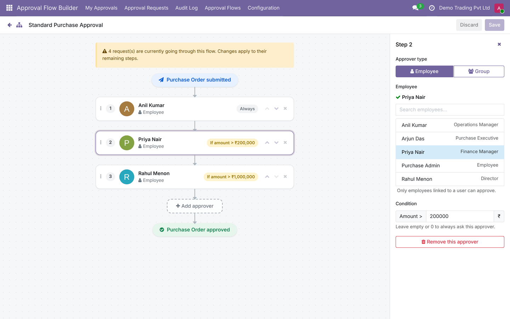

# Approval Flow Builder for Odoo 19


Multi-level **Purchase Order approvals** for Odoo 19 Community, with a **drag-and-drop visual builder**.

Design an approval chain (Manager → Finance → Director…), add amount conditions, and Odoo makes sure no Purchase Order is confirmed without the right sign-offs. Every decision is recorded in a tamper-proof audit log.



📖 **[User Guide](docs/USER_GUIDE.md)** — step-by-step instructions for administrators, requesters and approvers.

---

## Features

### Approval flows
- **Visual drag-and-drop builder** (Owl): add approvers, reorder by dragging, set amount conditions, save.
- Approvers can be a **specific employee** or a **user group** (any member can approve; implied groups included).
- **Amount conditions per step**: e.g. *Finance only when total > ₹2,000,000*. Steps that don't apply are skipped.
- Flows can be edited while requests are running; requests continue with their remaining steps.

### Purchase Order control
- **Minimum amount rule**: orders at or below the configured minimum are confirmed directly ("No approval needed"); orders above it must be approved.
- **Confirm Order is blocked** until the request is fully approved.
- **Order lock** while approval is in progress (lines, vendor, currency read-only).
- **Approved amount lock**: a confirmed order cannot be increased above the approved amount; reductions are allowed.
- Changing an approved RFQ, or *Cancel → Set to Draft*, **resets the approval** automatically.

### Approvers & requesters
- **My Approvals** kanban with one-click Approve / Reject.
- **Reject with a reason** (required) — the requester is notified with the reason.
- **Withdraw** a pending request, edit the order, and resubmit.
- **Self-approval policy** (setting): the person who submits a PO cannot approve it; the step is handed to an Approval Flow Administrator.
- To-do **activities** and inbox / email notifications for each approver; requester is notified on approval or rejection.

### Audit & security
- **Audit Log**: every Submitted / Approved / Rejected / Withdrawn event with user, step, date and reason. Logs are immutable.
- Record rules: users only see requests they submitted, decided, or must decide.
- Two security groups: **Approval Flow Approver** and **Approval Flow Administrator**.

---

## Screenshots

| My Approvals | Order locked while waiting |
|---|---|
|  |  |

| Reject with a reason | Request history |
|---|---|
|  |  |

| Audit Log | Settings |
|---|---|
|  |  |

| Below the minimum: no approval needed |
|---|
|  |

---

## Installation

**Requirements:** Odoo 19.0 Community, with the `purchase`, `hr` and `mail` apps.

**Option A — Odoo Apps Store:** download the module from the Odoo Apps Store, unzip the `approval_flow_builder` folder into your custom addons folder.

**Option B — from GitHub:**

1. Clone the repository anywhere, for example next to your other addons:
   ```bash
   cd /path/to
   git clone -b 19.0 https://github.com/6oshan/approval_flow_builder.git
   ```
   The module itself is the `approval_flow_builder/` folder **inside** the repository.
2. Add the **repository folder** to `addons_path` in your `odoo.conf`:
   ```ini
   addons_path = /path/to/odoo/addons,/path/to/approval_flow_builder
   ```
3. Restart Odoo and install:
   ```bash
   ./odoo-bin -c odoo.conf -d <your_db> -i approval_flow_builder
   ```
   or *Apps → Update Apps List → search "Approval Flow Builder" → Activate*.

To upgrade after pulling new code:
```bash
./odoo-bin -c odoo.conf -d <your_db> -u approval_flow_builder
```

---

## Configuration

1. **Users** – *Settings → Users*: give approvers the **Approval Flow Approver** role, and whoever designs flows the **Approval Flow Administrator** role (the admin user gets it automatically on install). Each employee used as an approver must be linked to a user.
2. **Flows** – *Approval Flow Builder → Approval Flows → New → Open Visual Builder*: add approvers in order and set optional amount conditions.
3. **Settings** – *Approval Flow Builder → Configuration → Settings*:

| Setting | What it does |
|---|---|
| Require approval + *When total is greater than* | Orders above this amount need approval; orders at or below it are confirmed directly. |
| Default approval flow | Pre-filled on new Purchase Orders; decides **who** approves. |
| Allow self-approval | Off (default): the submitter cannot approve their own order. |
| Currency for amount conditions | Currency used by amount conditions in the builder. |
| Email notifications | Notify approvers and requesters by inbox / email. |

---

## How it works

```
Purchase Order (RFQ)
   │  total ≤ minimum ──────────────► Confirm Order directly
   │  total > minimum
   ▼
Submit for Approval ──► Step 1 ──► Step 2 (if amount > X) ──► … ──► Approved ──► Confirm Order
                          │            │
                          └── Reject (reason) ──► Requester edits & resubmits
```

- Only the **current step's approver** sees the Approve / Reject buttons.
- A step whose amount condition does not match is skipped; if no step applies, the request is approved automatically.
- After confirmation, the order can't grow above the approved amount. To order more: *Cancel → Set to Draft → Submit again*.

---

## Technical overview

| Model | Purpose |
|---|---|
| `approval.flow` | Approval flow (template) with its steps; builder load/save API. |
| `approval.flow.step` | One approver (employee or group) with an optional amount condition. |
| `approval.flow.request` | Live request for one Purchase Order (state, current step, approved amount). |
| `approval.flow.log` | Immutable audit entry (submitted / approved / rejected / withdrawn + reason). |
| `approval.flow.reject.wizard` | Reject-with-reason dialog. |
| `purchase.order` (inherited) | Approval policy, submit / confirm checks, order lock, amount lock. |

- Frontend: Owl 2 client action (`approval_flow_builder/static/src/flow_builder`) with native HTML5 drag and drop.
- Security: `ir.model.access.csv` + record rules in `approval_flow_builder/security/`.

---

## Running the tests

```bash
./odoo-bin -c odoo.conf -d <test_db> -i approval_flow_builder \
    --test-enable --test-tags /approval_flow_builder --stop-after-init
```

23 tests cover the approval chain, group approvers, access rights, order locking, amount rules, self-approval, reject reasons and the builder API. Odoo's own Purchase test suite (116 tests) also passes with the module installed.

> Use a separate test database — tests create users and orders.

---

## Roadmap

- Exemptions by vendor, product category or user group
- Parallel / "any of" approvals
- Approvals for Vendor Bills and Expenses
- Approval dashboard (pending, average approval time)

---

## Author & license

**Roshan Jose Kurian** — [GitHub @6oshan](https://github.com/6oshan)

Licensed under the [GNU LGPL v3](LICENSE).
