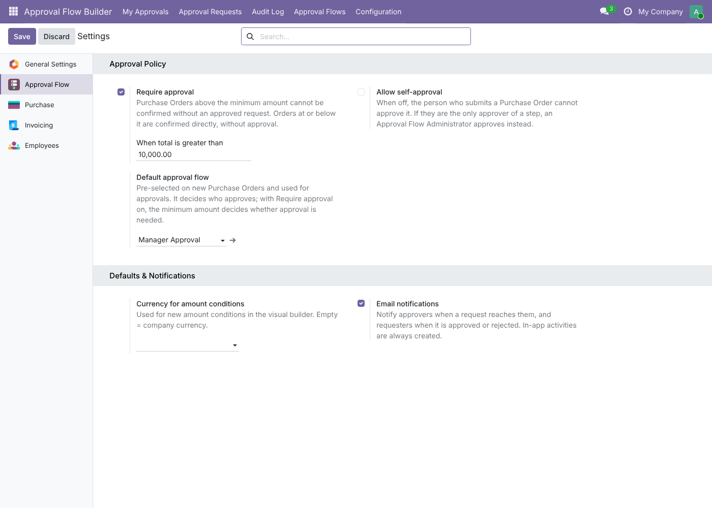
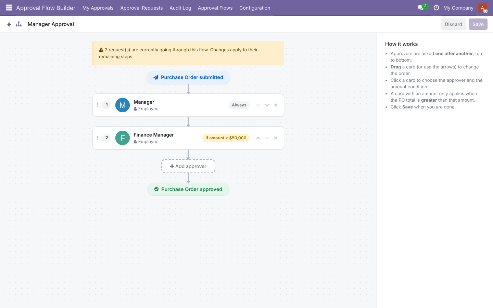
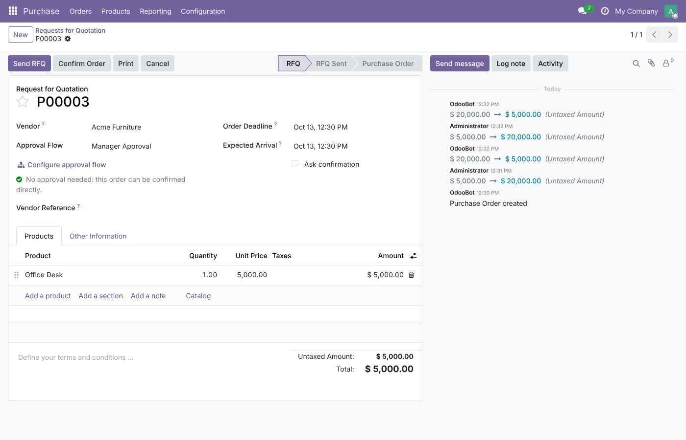
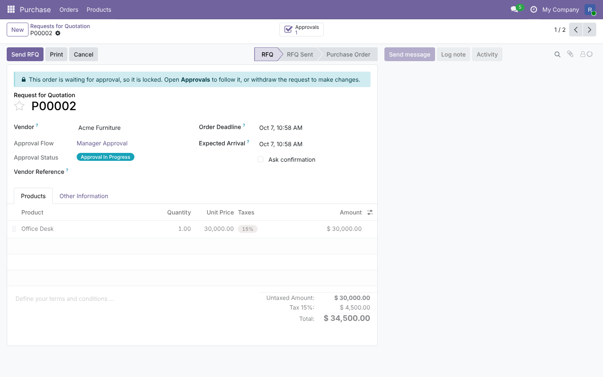
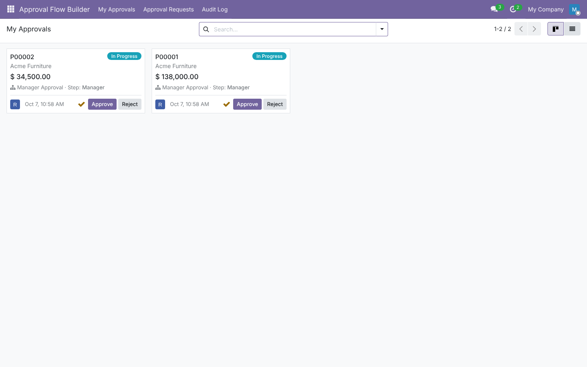
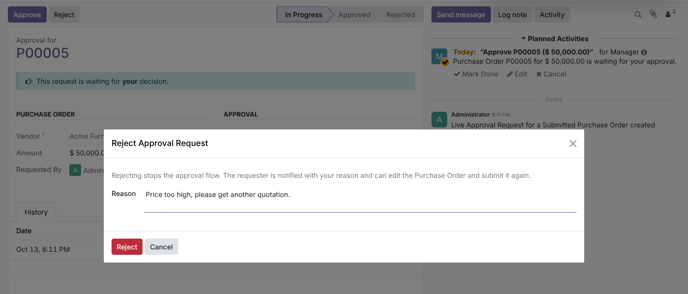
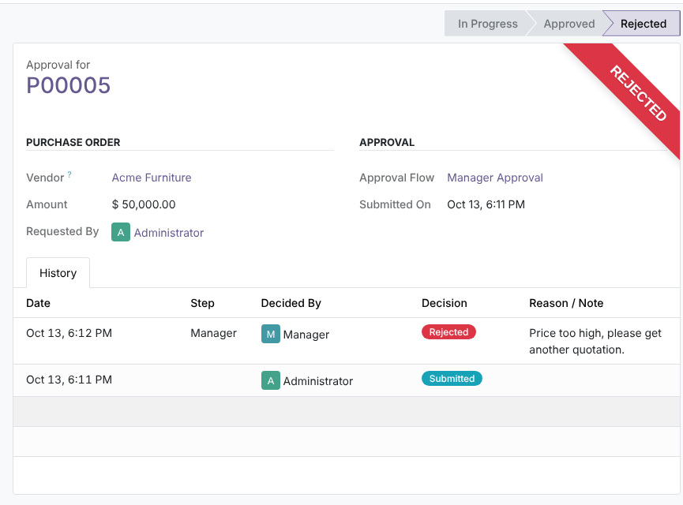
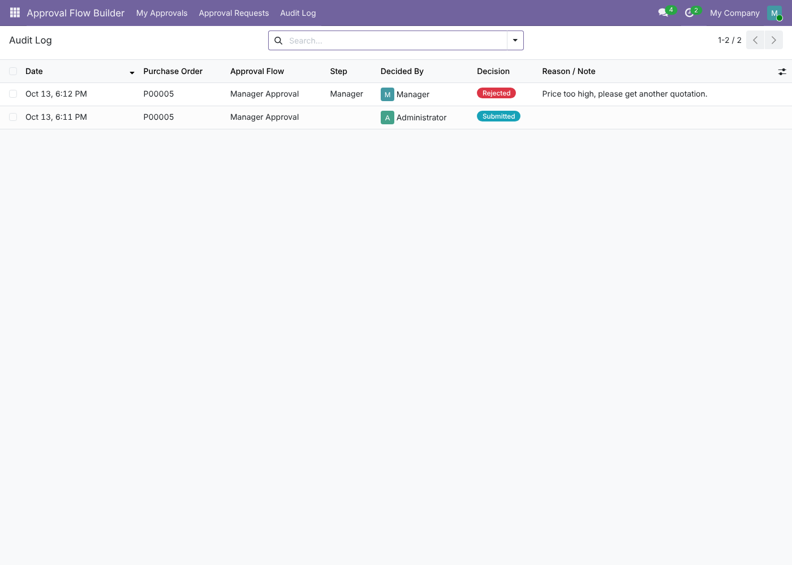

# Approval Flow Builder — User Guide

This guide explains how to use the module, by role. It covers version **19.0.1.2.0**.

- [1. Who does what](#1-who-does-what)
- [2. Administrator: first setup](#2-administrator-first-setup)
- [3. Building an approval flow](#3-building-an-approval-flow)
- [4. Requester: submitting a Purchase Order](#4-requester-submitting-a-purchase-order)
- [5. Approver: approving or rejecting](#5-approver-approving-or-rejecting)
- [6. After approval: confirming and changing orders](#6-after-approval-confirming-and-changing-orders)
- [7. History and Audit Log](#7-history-and-audit-log)
- [8. Rules at a glance](#8-rules-at-a-glance)
- [9. FAQ and troubleshooting](#9-faq-and-troubleshooting)

---

## 1. Who does what

| Role | Odoo access needed | What they do |
|---|---|---|
| **Requester** | Purchase / User | Creates Purchase Orders, submits them for approval, withdraws or resubmits, confirms approved orders. |
| **Approver** | Approval Flow → **Approver** | Approves or rejects requests that reach their step. |
| **Flow administrator** | Approval Flow → **Administrator** | Builds approval flows, can withdraw any request, takes over steps a requester may not approve. |
| **System administrator** | Settings | Installs the module, assigns roles, sets the Configuration options. |

---

## 2. Administrator: first setup

### 2.1 Give people their roles
*Settings → Users & Companies → Users → open a user → Access Rights tab*

- Approvers: set **Approval Flow** to **Approver**.
- People who design flows: set **Approval Flow** to **Administrator**.
- Requesters need at least **Purchase: User**.

### 2.2 Link employees to users
An approver chosen as an *employee* must have a **Related User** (*Employees → open the employee → HR Settings tab*). In the builder, employees without a user are shown greyed out as "No user linked".

### 2.3 Configuration
*Approval Flow Builder → Configuration → Settings*



| Setting | Recommended | What it does |
|---|---|---|
| **Require approval** + *When total is greater than* | On, e.g. 10,000 | Orders above this total need approval. Orders at or below it are confirmed directly. |
| **Default approval flow** | Your main flow | Pre-filled on every new Purchase Order. It decides **who** approves. |
| **Allow self-approval** | Off | When off, the person who submitted an order cannot approve it. |
| **Currency for amount conditions** | Company currency | Currency of the "If amount >" conditions in the builder. |
| **Email notifications** | On | Sends inbox / email notifications. To-do activities are always created. |

> The minimum is compared with the order **total including taxes**, and the rule is "greater than": with a minimum of 10,000, an order of exactly 10,000 needs no approval.

---

## 3. Building an approval flow

*Approval Flow Builder → Approval Flows → New*, give it a name and save, then click **Open Visual Builder**.
(From a Purchase Order, administrators can also click **Configure approval flow**.)



1. Click **+ Add approver**.
2. In the right panel choose **Employee** or **Group**, then pick the approver.
   - *Group*: any member of the group can approve (members of implied groups included).
3. Optional: enter an amount in **Amount >** — this step is then only used when the order total is greater than that amount. Leave it empty or 0 to always ask this approver.
4. Repeat for the next approvers. They are asked **one after another, top to bottom**.
5. Change the order by **dragging** a card or using the ▲ ▼ arrows. Remove a step with ✕.
6. Click **Save**. (**Discard** reverts to the last saved version.)

**Example:** Manager (always) → Finance Manager (if amount > 2,000,000). An order of 500,000 only goes to the Manager; an order of 3,000,000 goes to the Manager, then Finance.

> You can edit a flow while requests are using it (the builder shows a warning). Running requests continue with their remaining steps.

---

## 4. Requester: submitting a Purchase Order

1. *Purchase → New*, choose the vendor and add the lines. The **Approval Flow** is filled in from Configuration.
2. Look under the Approval Flow field:
   - **"No approval needed: this order can be confirmed directly."** → just click **Confirm Order**.

     
   - Otherwise click **Submit for Approval**. A message shows who it is waiting for.
3. While the request is in progress the order is **locked** (lines, vendor and currency are read-only), and **Confirm Order** is hidden.

   
4. Follow progress with the **Approvals** smart button at the top of the order.

**Need to change a waiting order?** Open the request (Approvals button) → **Withdraw** → edit the order → **Submit for Approval** again.

**Rejected?** You receive a message with the approver's reason. Edit the order if needed and click **Submit for Approval** again.

**Approved?** You receive a message. Click **Confirm Order**.

> Tip: totals update when you leave a field. If you just typed a new price, click outside the line before checking whether *Submit for Approval* is shown.

---

## 5. Approver: approving or rejecting

You are notified by a **to-do activity** (clock icon in the top bar) and, if enabled, by inbox / email.

*Approval Flow Builder → My Approvals* shows everything waiting for **you**:



- **Approve**: confirm the dialog. The request moves to the next approver, or becomes Approved if you were the last.
- **Reject**: enter a **reason** (required) and click **Reject**. The approval stops and the requester is notified with your reason.

  

Open a card to see the full request: order summary, amount, flow, current step and history.

> If self-approval is off and you submitted the order yourself, it will not appear in your My Approvals — an Approval Flow Administrator decides that step instead.

---

## 6. After approval: confirming and changing orders

| You want to… | What happens |
|---|---|
| Confirm the approved order | Click **Confirm Order**. |
| Change the price, quantity, vendor or currency of an **approved RFQ** (not yet confirmed) | Allowed, but the approval is **reset** — submit again. |
| **Increase** a **confirmed** order | Blocked above the approved amount: *"…was approved for X and cannot be increased to Y"*. |
| **Reduce** a confirmed order | Allowed. |
| Increase a confirmed order that **never needed approval** above the minimum | Blocked: *"…was confirmed without approval… now needs approval"*. |
| Order more after confirmation | **Cancel → Set to Draft** (the approval is reset) → edit → **Submit for Approval**. |

---

## 7. History and Audit Log

**History tab** on each request — every event with date, step, user, decision and reason:



| Decision | Meaning |
|---|---|
| **Submitted** | The requester sent the order for approval. |
| **Approved** | An approver approved their step. |
| **Rejected** | An approver rejected (reason shown in *Reason / Note*). |
| **Withdrawn** | The requester or an administrator withdrew the request. |

**Audit Log** (*Approval Flow Builder → Audit Log*) — the same entries for all orders, with filters (Submitted, Approved, Rejected, Withdrawn, My Decisions) and grouping by order, flow, user or decision. Entries cannot be edited or deleted.



---

## 8. Rules at a glance

```
Order total ≤ minimum ─────────────► Confirm Order directly
Order total > minimum
   │
   ▼
Submit ─► Step 1 ─► Step 2 (only if amount > X) ─► … ─► Approved ─► Confirm Order
             │          │
             └──────────┴─► Reject (reason) ─► requester edits ─► Submit again
```

- Only the **current approver** sees Approve / Reject.
- Steps whose amount condition does not match are **skipped**; if no step applies, the request is approved automatically.
- Users only see requests they submitted, decided, or must decide. Administrators see all.

---

## 9. FAQ and troubleshooting

**I can't see the Submit for Approval button.**
The order is at or below the minimum ("No approval needed"), it is already waiting / approved, or it is no longer an RFQ. If you just changed a price, click outside the line first.

**Confirm Order says the order needs approval.**
The total is above the minimum. Click **Submit for Approval**.

**An employee is greyed out in the builder.**
The employee has no related user. Link one in the Employees app.

**An approver doesn't see the request in My Approvals.**
Check that it is their step (open the request), that they have the *Approver* role, and — for group steps — that they belong to the group. With self-approval off, requesters don't see their own requests there.

**The chatter still shows the approval to-do after I approved.**
Refresh the page — the activity is already closed; the side panel just hasn't reloaded.

**I changed the module code and nothing changed in Odoo.**
Restart Odoo with `-u approval_flow_builder`, then hard-refresh the browser (Ctrl + Shift + R).
